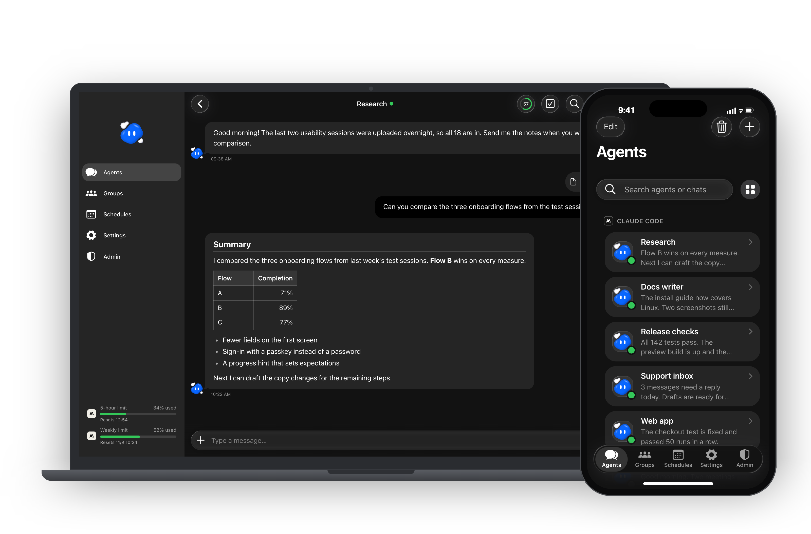
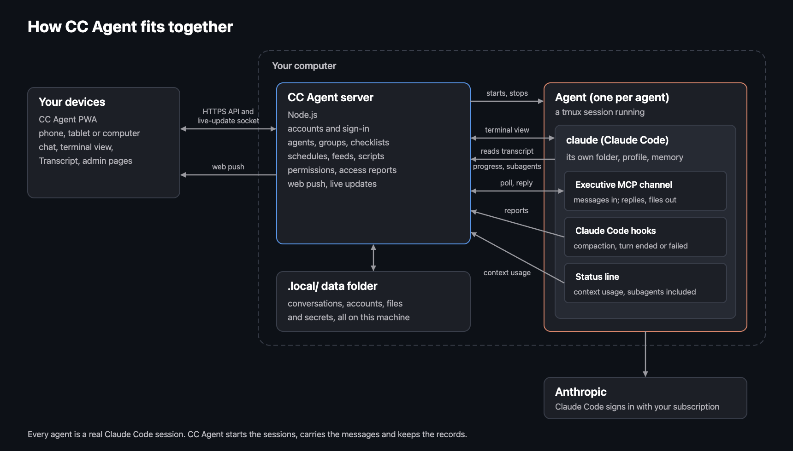
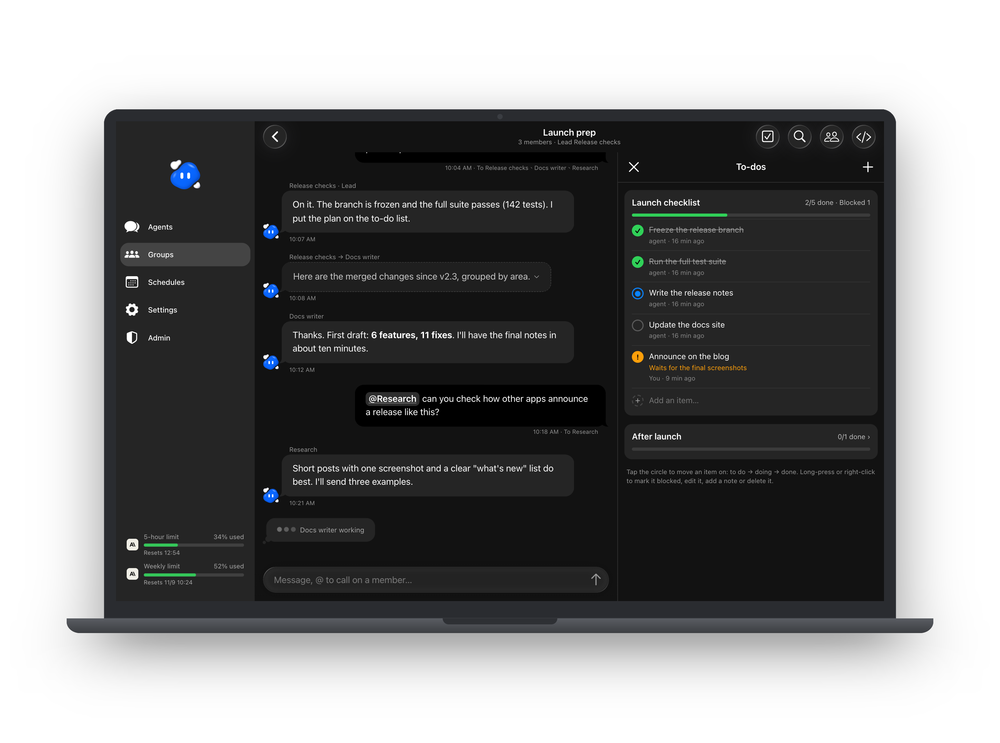
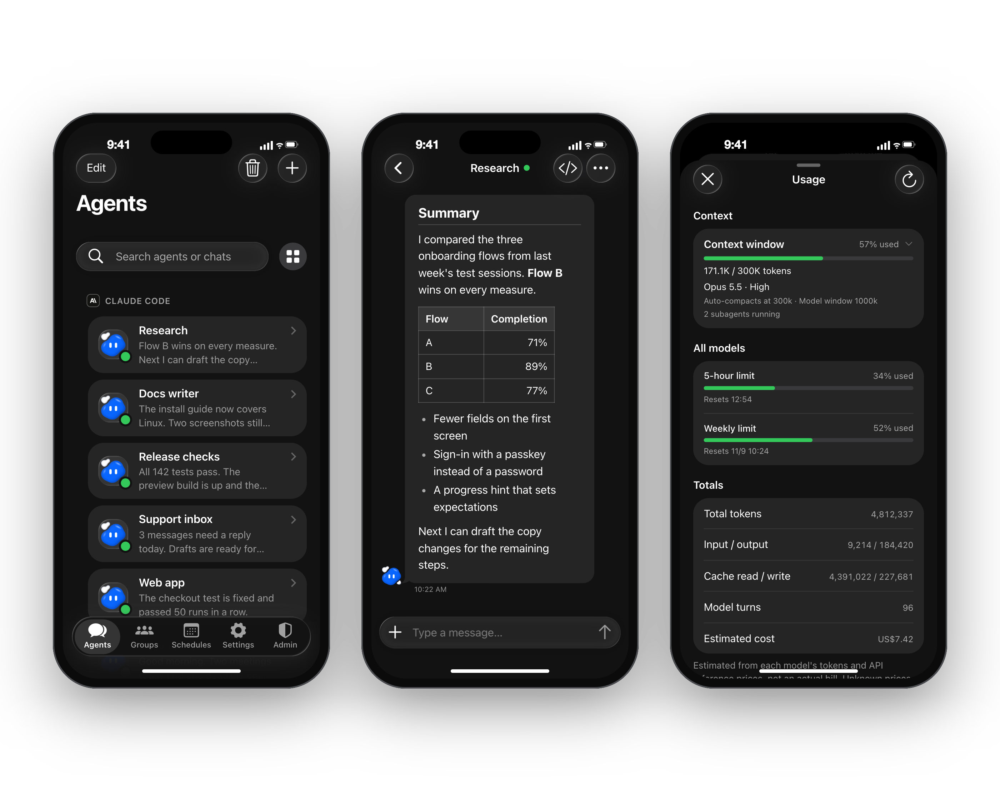
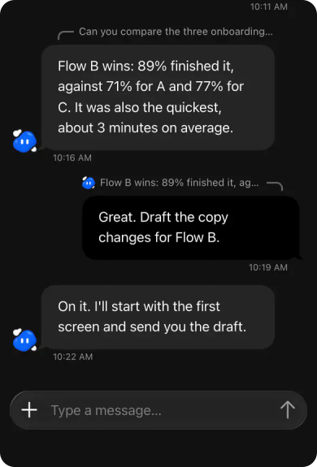
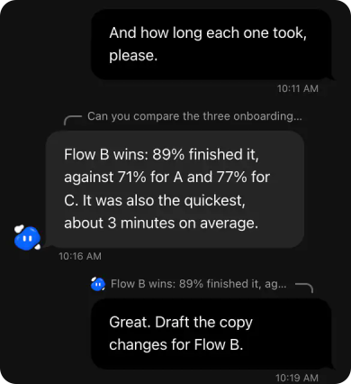
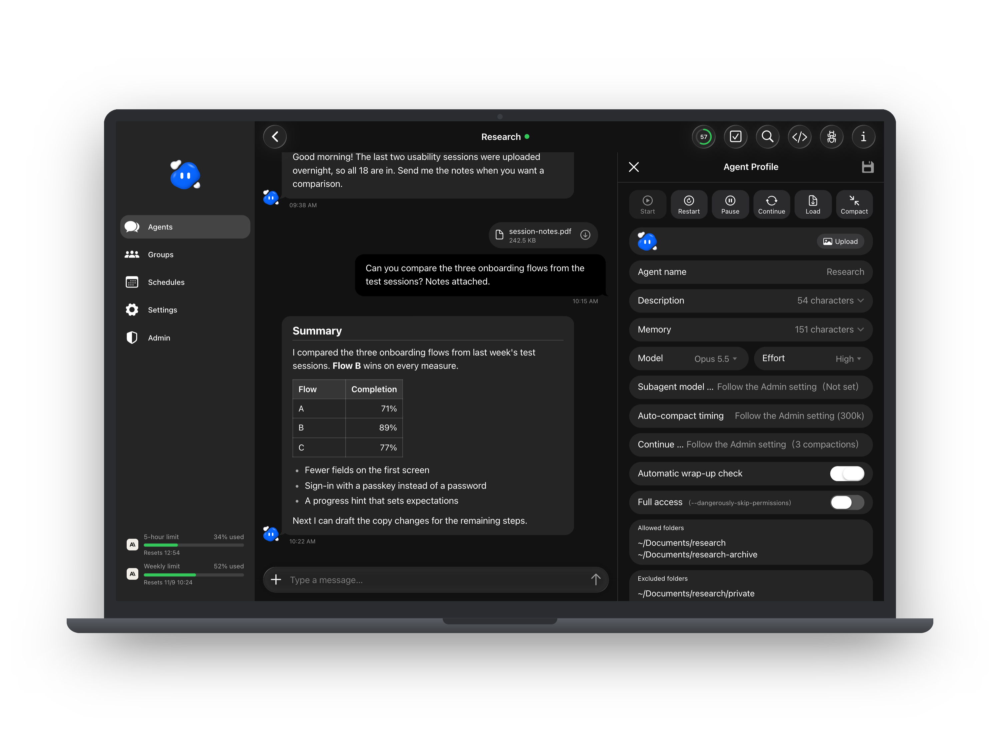
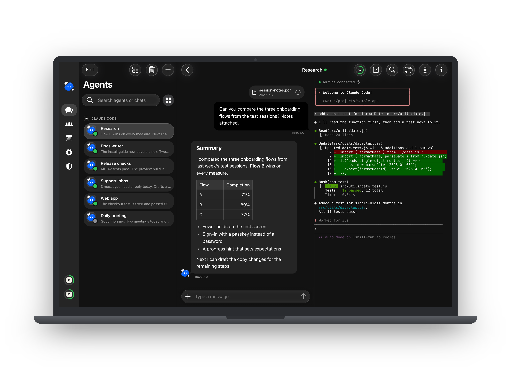
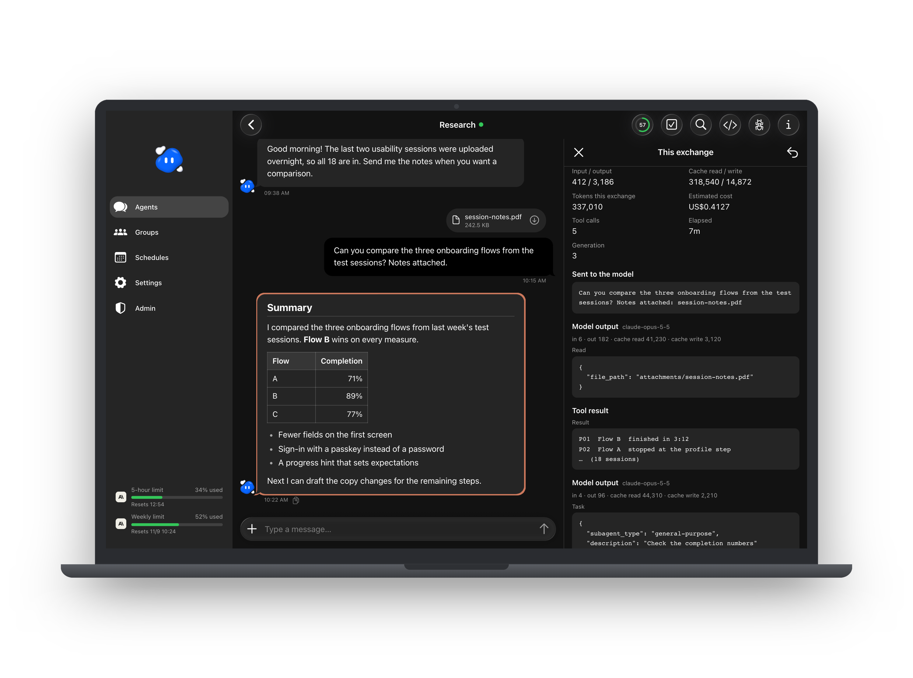

<p align="center">
  
</p>

<h1 align="center">CC Agent</h1>

<p align="center">
  <b>Your Claude Code subscription, as a personal multi-agent workspace.</b><br>
  A self-hosted PWA where each agent is a real Claude Code session you can talk to from any device.
</p>

<p align="center">
  English · <a href="README.zh-TW.md">繁體中文</a>
</p>

https://github.com/user-attachments/assets/90a97af2-27d7-4e70-9ba4-fd4103b0bdb6

<p align="center">
  
</p>

---

## What it is

Claude Code is a great agent, but it lives in a terminal. CC Agent puts a home screen around it.

You run it on your own Mac. Every agent you create is a real `claude` session in tmux, with its own folder, its own instructions and its own memory. Agents talk to the chat through CC Agent's built-in Executive MCP server, which CC Agent sets up for each agent on its own: there is nothing extra to install or configure. You talk to them from a chat app in the browser, or from the app installed on your phone. They keep working when you close the tab, and they tell you when they are done.

It uses the Claude Code you already have and the subscription you are already signed in with. There is no extra API bill and no cloud service in between.

<p align="center">
  
</p>

For every feature in detail, see [docs/FEATURES.md](docs/FEATURES.md).

## Highlights

<table>
<tr>
<td width="25%" align="center"></td>
<td><b>Many agents, one place.</b> Give each agent a role: one for a codebase, one for your inbox, one for research. Each keeps its own working folder, Agent Profile (what it is for, its boundaries, its current state) and long-term memory. Switch between them like chats in a messaging app.</td>
</tr>
<tr>
<td align="center"></td>
<td><b>Agents that work together.</b> Put several agents in a group chat with a lead, let them message each other, and follow shared to-do lists beside the conversation. Schedules wake an agent at set times, run small background scripts, or bring it new entries from an RSS feed. With the peer link, agents on two of your machines can message each other, even on different Claude accounts (<a href="docs/PEER-LINK.md">how</a>). An optional wrap-up check, off until an admin turns it on in the Admin tab, asks an agent that has finished a task to make sure its work is saved and its notes are current.</td>
</tr>
<tr>
<td align="center"></td>
<td><b>Full access, or a fenced folder.</b> Trust an agent with your whole machine, or let it read and write only the folders you allow and load only the local MCP servers you tick. Scoped agents run in Claude Code's sandbox and auto mode: they may fetch web pages when they judge it useful, with the domains you list approved in advance and Bash's network held to them, and anything they were refused is filed as a report for you to review.</td>
</tr>
<tr>
<td align="center"></td>
<td><b>Tells you when it matters.</b> Push notifications reach your phone when an agent replies or a schedule finishes. You can see a live view of what the agent is doing, how full its context is, its terminal, and its subagents, token use and cost.</td>
</tr>
</table>

<p align="center">
  
</p>

## Why a PWA

- **Install it like an app.** Add it to the home screen on iPhone, Android or desktop. It opens full screen, with its own icon, no app store.
- **Push notifications** on every platform that supports web push, including iOS home-screen apps.
- **One codebase, every screen.** A sidebar layout on a computer, a tab bar on a phone.
- **Always current.** When a new build is served, open pages notice within seconds and offer the update. Nothing reloads under you while you type.
- **Your machine, your data.** The server runs on your computer. Conversations, accounts and files stay in a folder you own.

## Designed for daily use

<p align="center">
  
</p>

<p align="center">
  
  
</p>

- **A chat that feels familiar.** A rounded composer that grows with your message, attachments with previews and upload progress, mentions, replies to a single message with a line showing what each reply answers, message search and jump-to-latest.
- **At home on a phone.** Swipe a bubble to the left to reply, or long-press it for copy, select text and reply over a dimmed page. The navbar and page sides follow iOS 26, and sheets open as pushed cards you pull down to close.
- **Live, not polling.** One small socket tells the page that something changed. Pages put away stop asking. Every tab signs in and out together.
- **Calm by default.** Light and dark themes, a quiet layout, and English and Traditional Chinese.
- **Sign-in done properly.** Password with two-step codes, passkeys (Face ID, Touch ID, Windows Hello), QR sign-in from your phone, a device list where you can sign any device out instantly, and protection against repeated guesses.

## See what your agents are doing

Open an agent's profile to set its job, memory, model and what it may touch. Switch to its terminal to watch the real Claude Code session, or open the transcript to see every turn's tool calls, tokens and cost.

<p align="center">
  
</p>

<p align="center">
  
</p>

<p align="center">
  
</p>

## What you need

CC Agent runs on your own computer. It has been built and used on macOS (Apple Silicon). Linux may work, but it has not been tested.

Use the latest release of each dependency: they regularly ship security fixes. The versions in brackets are the ones CC Agent was last tested with.

| Dependency | Why |
| --- | --- |
| [Claude Code](https://code.claude.com/docs/en/overview), latest (tested 2.1.306; 2.1.293 or later works), signed in | Every agent is a Claude Code session; CC Agent uses its channels and hooks |
| [Node.js](https://nodejs.org) 24 LTS, latest (tested 24.22.1; 22.12 or later works), and npm | Runs the server and builds the web app |
| [tmux](https://github.com/tmux/tmux), latest (tested 3.8; 3.5 or later works) | Keeps each agent's session running in the background |
| Xcode Command Line Tools (macOS) | Optional; provides python3 for background scripts written in Python |
| git | Optional; used for the version shown in the app |

To reach it from your phone outside your home network, put it behind HTTPS. [Cloudflare Tunnel](https://developers.cloudflare.com/cloudflare-one/connections/connect-networks/) is the supported way; if you use another reverse proxy, read [SECURITY.md](SECURITY.md) first. Push notifications and passkeys need HTTPS.

## Getting started

```sh
git clone https://github.com/xxxxDev/cc-agent.git
cd cc-agent
npm install
npm run build
npm start
```

It listens on `http://127.0.0.1:4280` by default. To change the port, or to tell it the HTTPS address you will open it from, copy `server/.env.example` to `server/.env` and set `CC_AGENT_PORT` and `CC_AGENT_PUBLIC_ORIGIN`.

On the first start it creates its data folder (`.local/`), its own secrets and push keys, and an `admin` account with a random password saved in `.local/local-access.json`, readable only by you. Sign in as `admin` with that password, change it, turn on two-step sign-in or add a passkey, then create an agent, pick a folder for it, and say hello.

Locked out? On the computer CC Agent runs on, `node scripts/sign-in-rescue.mjs two-step <username>` turns that account's two-step sign-in off, `protection <username>` lifts the account's sign-in protection, and `block <ip address>` lifts an address's block. Restart CC Agent within a day to apply it.

## Running on other systems

So far CC Agent has only been deployed on macOS with Apple silicon. If you run it on another system, please verify it yourself. Some notes to start from:

- **Linux:** install a C++ build toolchain before `npm install`. node-pty, used by the terminal view, ships no prebuilt binary for Linux and is compiled on install. Scoped agents also need `bubblewrap` and `socat` for Claude Code's sandbox.
- **Windows (experimental):** it runs natively on Windows 11 with [psmux](https://psmux.pages.dev) in place of tmux (`scoop install psmux` puts a `tmux.exe` on your PATH), or inside WSL. Natively you need a native `claude.exe` installation; the npm `claude.cmd` alone cannot start an agent. You also need [Git for Windows](https://git-scm.com/download/win): Claude Code runs its shell tool through Git's `bash.exe`, which CC Agent finds by itself (or set `CLAUDE_CODE_GIT_BASH_PATH`). The difference there: only **full-access** agents run, and a new agent starts with full access. Claude Code has no sandbox on Windows, so a scoped agent refuses to start and says why.
- **macOS-only parts:** background scripts in schedules run in the macOS sandbox, and the Claude usage meter reads Claude Code's login from the macOS Keychain (on Windows, from `~/.claude/.credentials.json`). Elsewhere, these two do not work yet.

If you get it running somewhere new, an issue describing what you had to change is welcome.

## A starting point, not a finished product

This is an open-source base. It does one thing well: it runs Claude Code agents for a person or a small team. It is meant to be extended:

- **Other models.** Add launchers for other agent runtimes or model APIs next to native Claude Code.
- **Teams.** Build on the existing admin and member accounts with your own roles, per-user isolation and permissions.
- **Your own integrations.** Connect agents to the tools your work runs on through MCP servers, schedules and background scripts.

Most of the product's own values (storage keys, labels, settings) live in `server/siteConfig.js`, `src/js/productConfig.js` and `public/push-config.js`. To rebrand it fully, also change the icons in `public/`, the name in `index.html`, the PWA manifest in `vite.config.js` and `public/reset-sw.html`, and the product name where it appears in interface text.

## Related projects

- **[castpane](https://github.com/xxxxDev/castpane)**: see and control your Mac from a phone or another computer, in the browser. One Mac app, nothing to install on the phone, several Macs in one web app.
- **[agent-courier](https://github.com/xxxxDev/agent-courier)**: messages between plain Claude Code sessions on your own machines, over SSH, as CC Agent's peer link does for its agents.

## Security

Agents run with your user's permissions. A full-access agent can do anything you can do on that machine, so only grant full access to agents you would trust with your terminal. Scoped agents are fenced by Claude Code's sandbox and CC Agent's own checks, but no sandbox is perfect. Please read [SECURITY.md](SECURITY.md) before exposing CC Agent to the internet, and report vulnerabilities as described there.

## Contributing

Issues and pull requests are welcome. See [CONTRIBUTING.md](CONTRIBUTING.md).

## License

The code is released under the [MIT License](LICENSE).

The CC Agent character artwork (the blue liquid character in this README and the app icons) belongs to [V-AX](https://v-ax.com) and is **not** covered by the MIT License. See [BRAND.md](BRAND.md).

CC Agent is an independent project. It is not made by, affiliated with or endorsed by Anthropic. Claude and Claude Code are trademarks of Anthropic.
