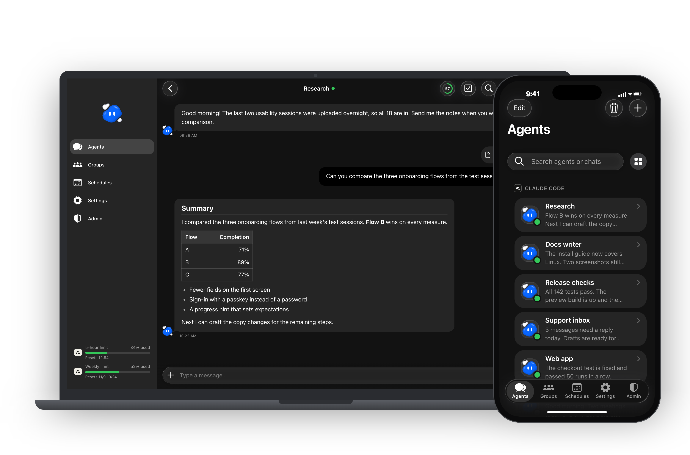
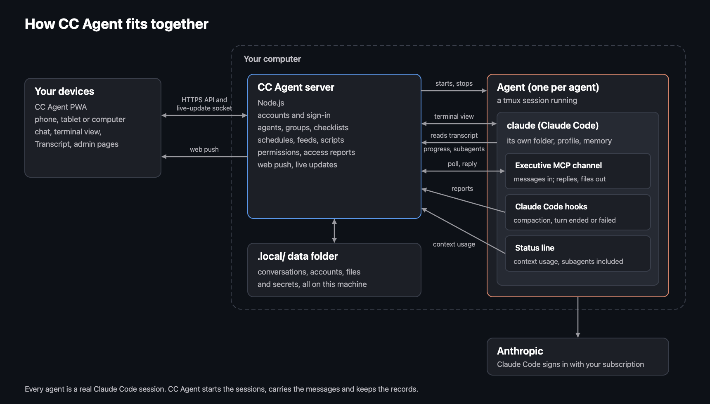
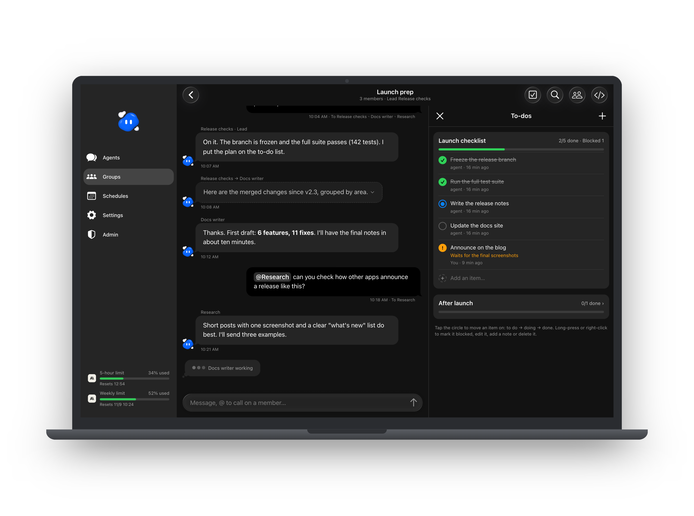
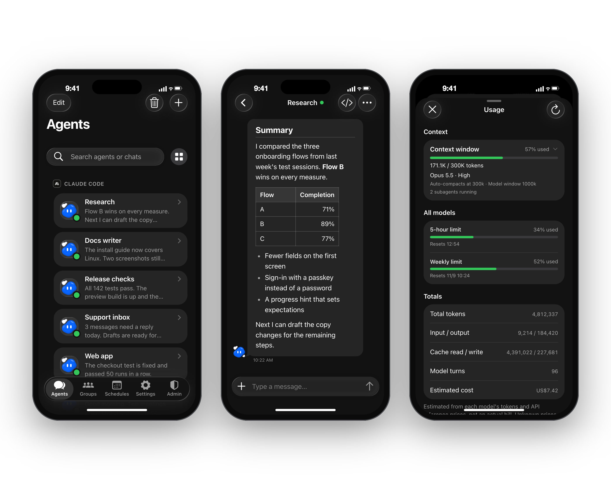
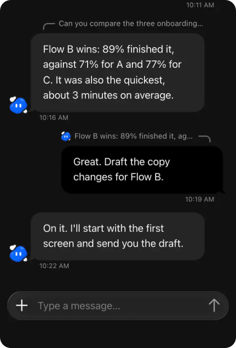
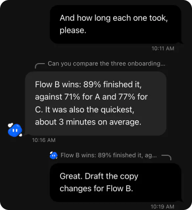
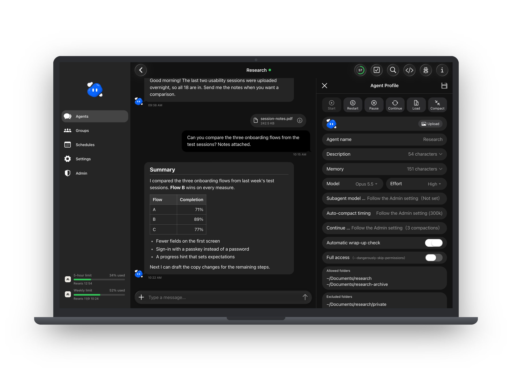
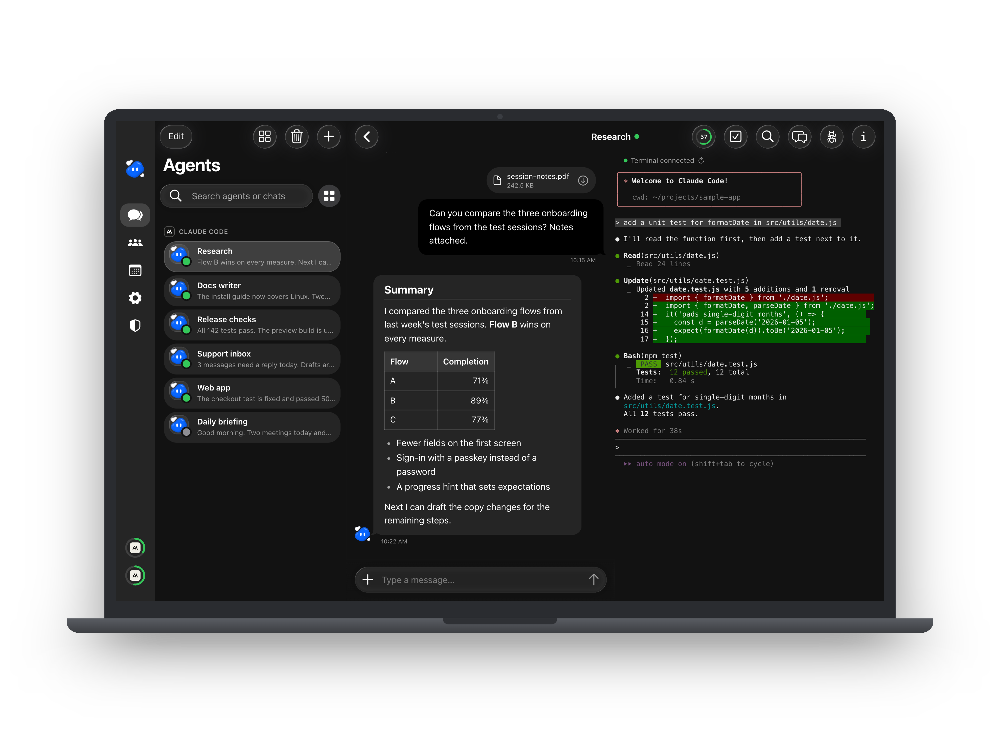
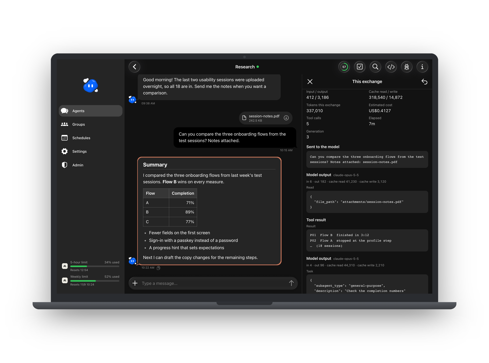

<p align="center">
  
</p>

<h1 align="center">CC Agent</h1>

<p align="center">
  <b>把你的 Claude Code 訂閱，變成個人化的多 agent 工作平台。</b><br>
  自己架設的 PWA，每個 agent 都是一個真正的 Claude Code session，在任何裝置上都能跟它對話。
</p>

<p align="center">
  <a href="README.md">English</a> · 繁體中文
</p>

https://github.com/user-attachments/assets/90a97af2-27d7-4e70-9ba4-fd4103b0bdb6

<p align="center">
  
</p>

---

## 這是什麼

Claude Code 是很強的 agent，但它住在終端機裡。CC Agent 幫它蓋了一個家。

CC Agent 跑在你自己的 Mac 上。你建立的每個 agent，都是 tmux 裡一個真正的 `claude` session，有自己的資料夾、自己的說明和自己的記憶。agent 透過 CC Agent 內建的 Executive MCP server 跟聊天室溝通，CC Agent 會自動幫每個 agent 設定好，不用另外安裝或設定。你可以在瀏覽器的聊天介面跟它們對話，也可以用裝在手機上的 App。關掉分頁，它們還是會繼續做事，做完會通知你。

它用的是你已經裝好的 Claude Code，和你已經登入的訂閱。沒有額外的 API 費用，中間也沒有雲端服務。

<p align="center">
  
</p>

所有功能的詳細說明，請看 [docs/FEATURES.zh-TW.md](docs/FEATURES.zh-TW.md)。

## 功能

<table>
<tr>
<td width="25%" align="center"></td>
<td><b>很多 agent，一個地方。</b>每個 agent 有自己的角色：一個管程式碼，一個處理信件，一個做研究。各自有工作資料夾、Agent Profile（用途、界線、目前狀態）和長期記憶，像通訊軟體裡的聊天室一樣切換。</td>
</tr>
<tr>
<td align="center"></td>
<td><b>agent 之間可以合作。</b>把幾個 agent 放進群組，指定一個主負責，讓它們互傳訊息，在對話旁邊跟著同一份待辦事項進行。排程可以在固定時間叫醒 agent、執行小型背景腳本，或把 RSS 的新文章帶給它。透過跨機連線，你兩台電腦上的 agent 也能互傳訊息，就算登入不同的 Claude 帳號也可以（<a href="docs/PEER-LINK.md">設定方式</a>，英文）。另有選用的自動收尾檢查，預設關閉，管理員可在管理頁開啟：agent 完成任務後，會請它確認工作已保存、筆記是最新的。</td>
</tr>
<tr>
<td align="center"></td>
<td><b>完整權限，或圈好的範圍。</b>信任的 agent 可以給整台電腦的權限；其他的只能讀寫你允許的資料夾、只載入你勾選的本機 MCP。限定範圍的 agent 跑在 Claude Code 的沙盒與 auto mode 裡：上網由它自己判斷，你列的網域只是預先放行，Bash 的網路則被沙盒限制在這些網域；被擋下的動作會寫成報告讓你審。</td>
</tr>
<tr>
<td align="center"></td>
<td><b>重要的事會通知你。</b>agent 回覆或排程完成時，推播會送到你的手機。你也能即時看到 agent 正在做什麼、它的 context 用了多少、它的終端機、它開的子代理、token 用量和費用。</td>
</tr>
</table>

<p align="center">
  
</p>

## 為什麼是 PWA

- **像 App 一樣安裝。**在 iPhone、Android 或電腦上加到主畫面，全螢幕開啟、有自己的圖示，不用上架商店。
- **推播通知**：支援 web push 的平台都能收，包括 iPhone 主畫面上的 App。
- **一套程式，每種螢幕。**電腦是側邊欄，手機是下方分頁列。
- **永遠是新版。**伺服器換上新版時，開著的頁面幾秒內就會發現並提示更新；你打字時不會突然重新整理。
- **你的電腦、你的資料。**伺服器跑在你自己的電腦上，對話、帳號和檔案都在你自己的資料夾裡。

## 為日常使用而設計

<p align="center">
  
</p>

<p align="center">
  
  
</p>

- **熟悉的聊天介面。**圓角輸入框會隨內容長高，附件有預覽和上傳進度，支援提及、回覆單一則訊息（回覆上方標出它回答哪一則）、訊息搜尋和回到最新。
- **在手機上順手。**把泡泡往左滑就能回覆，長按會在變暗的頁面上叫出複製、選取文字和回覆。標題列和頁面兩側跟 iOS 26 一樣，面板像推出的卡片，往下拉就關。
- **即時，不輪詢。**一條小小的連線通知頁面「有變動」；收起來的頁面不再發請求；所有分頁一起登入、一起登出。
- **安靜的預設。**淺色與深色主題，版面乾淨，介面有中文和英文。
- **認真做好的登入。**密碼加兩步驟驗證、通行密鑰（Face ID、Touch ID、Windows Hello）、用手機掃碼登入、可以立刻登出任何裝置的裝置清單，以及防止重複猜密碼的保護。

## 看得到 agent 在做什麼

打開 agent 的 Profile，設定它的用途、記憶、模型和能碰的範圍。切到終端機，看真正的 Claude Code session 在跑什麼；或打開 transcript，看每一輪用了哪些工具、多少 token 和費用。

<p align="center">
  
</p>

<p align="center">
  
</p>

<p align="center">
  
</p>

## 需求

一台 Apple 晶片的 Mac，CC Agent 就是在上面開發與使用的。其他系統見[限制](#限制)。

請盡量使用各項的最新版，它們會定期推出安全修正。括號裡是 CC Agent 最近一次測試用的版本。

| 需要 | 用途 |
| --- | --- |
| [Claude Code](https://code.claude.com/docs/en/overview) 最新版（測試過 2.1.306；2.1.293 以上可用），且已登入 | 每個 agent 都是一個 Claude Code session，CC Agent 用它的 channels 與 hooks |
| [Node.js](https://nodejs.org) 24 LTS 最新版（測試過 24.22.1；22.12 以上可用）與 npm | 執行伺服器、建置網頁 |
| [tmux](https://github.com/tmux/tmux) 最新版（測試過 3.8；3.5 以上可用） | 讓每個 agent 的 session 在背景持續執行 |
| Xcode Command Line Tools（macOS） | 選用，排程背景腳本用 Python 時提供 python3 |
| git | 選用，App 顯示的版本號會用到 |

CC Agent 只在這台電腦上接受連線（`127.0.0.1`）。其他任何裝置，包括同一個家用網路裡的手機，都要透過 HTTPS 和 `CC_AGENT_PUBLIC_ORIGIN` 設定的網址連線。建議用 [Cloudflare Tunnel](https://developers.cloudflare.com/cloudflare-one/connections/connect-networks/)；用其他反向代理之前，請先讀 [SECURITY.md](SECURITY.md)。推播和通行密鑰也都需要 HTTPS。

## 快速開始

```sh
git clone https://github.com/xxxxDev/cc-agent.git
cd cc-agent
npm install
npm run build
npm start
```

預設在 `http://127.0.0.1:4280`。要改埠號，或告訴它你會用哪個 HTTPS 網址開啟，把 `server/.env.example` 複製成 `server/.env`，設定 `CC_AGENT_PORT` 和 `CC_AGENT_PUBLIC_ORIGIN`。

第一次啟動時，它會建立資料夾 `.local/`、自己的密鑰和推播金鑰，以及一個 `admin` 帳號，隨機密碼存在 `.local/local-access.json`（只有你讀得到）。用 `admin` 和這組密碼登入、改掉密碼、開啟兩步驟驗證或加一把通行密鑰，接著建立一個 agent、幫它選個資料夾，跟它打聲招呼。

被鎖在外面時，在執行 CC Agent 的電腦上跑 `node scripts/sign-in-rescue.mjs two-step <帳號>` 可以關掉那個帳號的兩步驟驗證，`protection <帳號>` 解除帳號的登入保護，`block <IP 位址>` 解除 IP 的封鎖。之後在一天內重新啟動 CC Agent 就會套用。

## 一個起點，不是成品

這是開源的基礎版。它專心做好一件事：替一個人或一個小團隊執行 Claude Code agent。它就是拿來擴充的：

- **其他模型。**在原生 Claude Code 旁邊，加上其他 agent 執行環境或模型 API 的啟動方式。
- **團隊。**在現有的管理員與一般帳號上，加入自己的角色、使用者隔離與權限。
- **你的整合。**透過 MCP、排程和背景腳本，把 agent 接上你工作用的工具。

大部分產品自己的值（儲存名稱、標籤、設定）集中在 `server/siteConfig.js`、`src/js/productConfig.js`、`public/push-config.js`。要完整換成你自己的品牌，還要換 `public/` 的圖示、`index.html` 的名稱、`vite.config.js` 的 PWA manifest 與 `public/reset-sw.html`，以及介面文字裡出現產品名稱的地方。

## 相關專案

- **[castpane](https://github.com/xxxxDev/castpane)**：在瀏覽器裡看並操作你的 Mac，手機或另一台電腦都可以。Mac 裝一個 App，手機不用裝任何東西，一個網頁還能看多台 Mac。
- **[agent-courier](https://github.com/xxxxDev/agent-courier)**：讓你自己幾台電腦上的一般 Claude Code session 透過 SSH 互傳訊息，就像 CC Agent 的跨機連線之於它的 agent。

## 限制

- **只在 Apple 晶片的 macOS 上測試過。** 在其他系統上請自行確認：下面幾點可以當起點，也歡迎開 issue 說明你改了哪些地方。
- **Linux：** `npm install` 之前先裝好 C++ 編譯工具。終端機檢視用的 node-pty 沒有 Linux 的現成版本，安裝時會現場編譯。限定範圍的 agent 另外需要 `bubblewrap` 和 `socat`，Claude Code 的沙盒要用到。
- **Windows（實驗性）：** 可以在 Windows 11 原生執行，用 [psmux](https://psmux.pages.dev) 取代 tmux（`scoop install psmux` 會把 `tmux.exe` 放進 PATH），也可以在 WSL 裡執行。原生執行需要原生安裝的 `claude.exe`，只有 npm 的 `claude.cmd` 無法啟動 agent。另外還需要 [Git for Windows](https://git-scm.com/download/win)：Claude Code 的 shell 工具要透過 Git 的 `bash.exe` 執行，CC Agent 會自己找到它（也可以用 `CLAUDE_CODE_GIT_BASH_PATH` 指定）。Windows 上的差異：只能執行**完整權限**的 agent，新建的 agent 也預設完整權限。Windows 上的 Claude Code 沒有沙盒，限定範圍的 agent 會拒絕啟動並說明原因。
- **只能在 macOS 用的部分：** 排程的背景腳本只在 macOS 上執行，用它的沙盒。Claude 用量從 macOS 鑰匙圈讀 Claude Code 的登入，Windows 上改讀 `~/.claude/.credentials.json`；Linux 上沒有這項。

## 文件

- [docs/FEATURES.zh-TW.md](docs/FEATURES.zh-TW.md)：所有功能的詳細說明。
- [docs/PEER-LINK.md](docs/PEER-LINK.md)：配對兩套安裝，讓兩邊的 agent 互傳訊息（英文）。
- [docs/push-keys.md](docs/push-keys.md)：更換推播金鑰（英文）。
- [SECURITY.md](SECURITY.md)：CC Agent 該怎麼執行，以及怎麼回報漏洞（英文）。
- [CONTRIBUTING.md](CONTRIBUTING.md)：怎麼提出修改（英文）。
- [BRAND.md](BRAND.md)：角色圖，不在 MIT 授權內（英文）。

## 安全

agent 用你的使用者權限執行。完整權限的 agent 能在那台電腦上做任何你能做的事，所以只把完整權限給你願意交出終端機的 agent。限定範圍的 agent 有 Claude Code 沙盒和 CC Agent 自己的檢查，但沒有沙盒是完美的。把 CC Agent 開放到網路上之前，請先讀 [SECURITY.md](SECURITY.md)，回報漏洞也照那裡的方式。

## 參與貢獻

歡迎開 issue 和 pull request，請看 [CONTRIBUTING.md](CONTRIBUTING.md)。

## 授權

程式碼以 [MIT License](LICENSE) 釋出。角色圖不在此授權內，見 [BRAND.md](BRAND.md)。

CC Agent 是獨立專案，並非由 Anthropic 製作，也與其沒有關係或背書。Claude 與 Claude Code 是 Anthropic 的商標。

由 [V-AX](https://v-ax.com) 製作。
