# CC Agent 功能說明

[English](FEATURES.md) · 繁體中文

這份是完整介紹，[README](../README.zh-TW.md) 是精簡版。

## Agent

- **建立 agent。** 設定名稱、用途、要長久記得的內容、模型與 effort，以及工作資料夾。只有管理員能建立 agent，可以建給自己，也可以建給其他帳號。
- **Agent Profile。** 每個 agent 都有一份 Profile，寫它的用途、邊界和目前狀況。agent 會自己更新，每次更新都會在聊天室出現一張卡片。旁邊還有它的長期記憶。
- **接續既有的 session。** 管理員可以輸入本機 Claude Code 的 session ID，新的 agent 就接著那段對話繼續。也可以請 session 用 JSON 介紹自己，貼進建立表單自動填好。
- **啟動、暫停、重啟。** 暫停會中斷正在回覆的內容，聊天紀錄會保留。重啟會接回同一個 session。清單上也可以一次暫停或重啟全部 agent。
- **保存 Profile。** Agent Profile 的修改用一個「保存」按鈕一次存好，有改動時按鈕才會亮。換模型、effort 或存取範圍時，agent 會重新連線，對話會保留。要等 agent 重新啟動才生效的設定只問一次：現在重新啟動，或等這次回覆完成再重啟。有未保存的修改時，關掉 Profile 會先問要不要放棄；啟動、重啟、暫停、接續等操作會先問要不要保存。
- **子代理模型與 Effort。** 管理員在管理頁設定完整權限 Claude agent 的子代理要用的模型和 Effort，也可以鎖定模型，讓所有子代理都用同一個。個別 agent 可以跟隨管理設定，或在 Agent Profile 自己設定。改了要等 agent 重新啟動才生效。
- **自動壓縮時機。** 決定 Claude Code 什麼時候壓縮 agent 的對話：Claude Code 預設，或用到 20、30、40、50、70 萬 token 時。管理員在管理頁的「接續」群組設定，個別 agent 可以跟隨管理設定，或在 Agent Profile 自己設定。設太低會一直壓縮，光是啟動就可能用掉 5 萬以上。改了要等 agent 重新啟動才生效。
- **接續到新的 session。** 對話太長時 Claude Code 會壓縮。壓縮達到設定次數後（預設 5 次，管理員可改，設 0 就關閉；個別 agent 可以在 Agent Profile 自己設定次數），CC Agent 會先保存 agent 的記憶和最近的訊息，再換到新的 Claude Code session 繼續。也可以按「接續」手動接續。
- **接續時帶入訊息。** 預設帶入最近 12 則，管理員可以改成 0 到 50 則。按「接續」時會先問要帶幾則，管理員也可以關掉這個詢問。「接續後」選「等第一則訊息」時，新 session 要等下一則訊息進來才啟動，省下沒人用的 session 的開機額度。
- **刪除的 agent。** 刪除後會從清單移除，可以連同原本的 session 一起救回。預設不刪除；管理員可以設定 7 到 365 天後永久刪除。
- **重新登入 Claude。** 這台電腦上的 Claude 登入失效時，聊天室會出現一張卡片，並送出推播通知。管理員直接在卡片上，或輸入 `/login`，就能重新登入，不用開終端機。這台電腦的 agent 共用同一個登入。
- **能啟動其他 agent 的 agent。** 這台電腦的擁有者可以在 `.local/agent-starters.json`（`{"conversationIds": [...]}`）用對話 ID 列出 agent。列出的必須是管理員的完整權限 Claude agent。它下次啟動後，就能列出啟用中帳號的 Claude agent，並啟動停止中的 agent；被啟動的 agent 用自己的 Profile 和權限，聊天室也會寫出是誰啟動的。
- **頭像與排序。** 可以幫 agent 換頭像、拖曳調整清單順序，也可以把 agent 分組。

  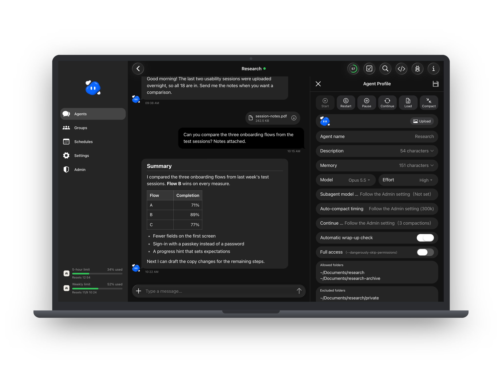

## 聊天

- **雙向傳訊息與檔案。** 可以傳文字和附件（一則訊息最多 10 個檔案，每個最大 95 MB），agent 也能回傳檔案（一次回覆最多 5 個，每個最大 25 MB），都有預覽。在電腦上可以直接把檔案拖進聊天室附加。
- **@ 提及、搜尋、跳到最新。** 可以在單一對話裡搜尋訊息，點結果直接跳過去。
- **回覆某一則訊息。** 用滑鼠時，按泡泡下方複製旁邊的回覆按鈕；在手機上把泡泡往左滑，或長按叫出圓形的複製與回覆按鈕。要回覆的訊息會顯示在輸入框上方，按 X（或 Esc）取消。agent 會知道你回覆的是哪一則和它的開頭幾個字，也能讀到全文。
- **回覆的是哪一則。** agent 的回覆在需要時會在上方用一行標出它回答的訊息：誰寫的和開頭幾個字。中間隔了別的訊息，或一次回答了好幾則時才會出現（「＋N 則」可以展開其餘的）。你自己的回覆一定會顯示。點這一行就跳到那則訊息。
- **斜線指令。** 輸入 `/` 就能用 Claude Code 自己的指令，例如 `/compact`、`/context`、`/mcp`、`/usage`、`/status`、`/diff`。這些指令會在 agent 的終端機裡執行。
- **終端機跳出的問題。** Claude Code 在終端機停下來問事情時，例如權限詢問或選擇題，聊天室會出現一張卡片，直接在卡片上回答。
- **中斷這一輪。** 中斷正在回覆的內容，不會停掉 agent。
- **待辦事項。** agent 會把步驟、待辦和要驗證的事放在聊天室旁邊「待辦事項」裡的清單。點一下項目會往下一個狀態走（待辦、進行中、完成）；長按可以標成卡住、加備註、修改或刪除。你也可以自己加項目。
- **已完成的待辦事項。** 預設每份清單都保留。管理員可以在管理頁「收尾」群組的「已完成的待辦事項保留」設定：整份清單的項目都完成後，從最後一次更新起算 1、3、7 或 30 天自動刪除。還有未完成、進行中或卡住項目的清單不會刪，已刪除的 agent 的清單也不會動。
- **收尾檢查（選用）。** 預設關閉，要管理員在管理頁打開。打開後，agent 做完任務、閒置 10 分鐘後（管理員可以調整等待時間），會被提醒確認工作都已保存、筆記都是最新的。只讀資料或只回答問題的那一輪不會提醒，還有背景指令或子代理在跑時也不會提醒。管理員可以改提醒的內容；個別 agent 可以在 Agent Profile 關掉「自動收尾檢查」。

  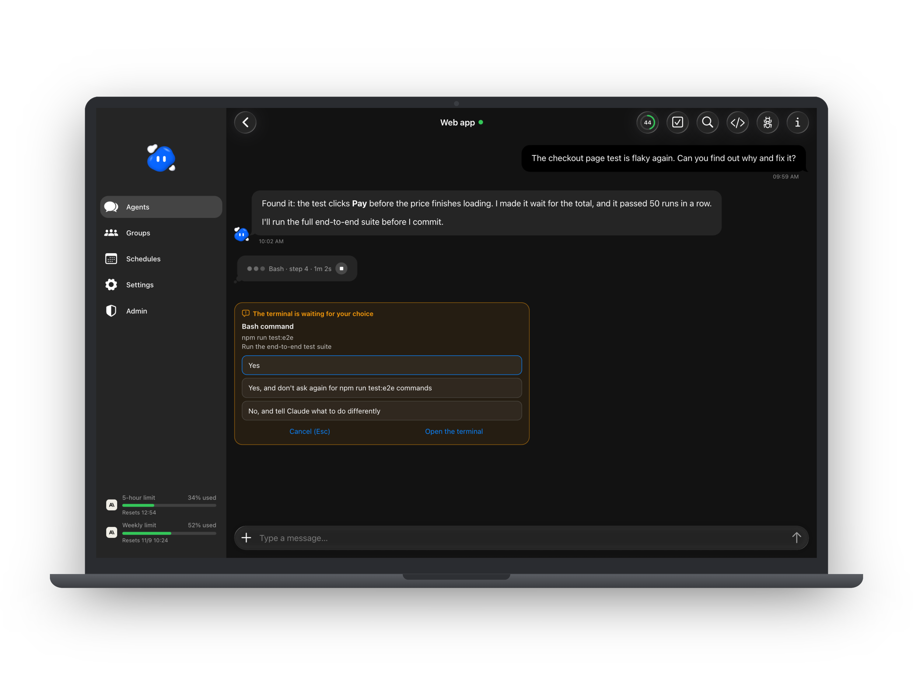

## 群組

- **群組聊天。** 把幾個 agent 放進同一個聊天室，再指定一位負責人。
- **誰來回答。** 訊息開頭用 `@` 點到的成員會收到；用 `@All` 就是全部成員；都沒點名就交給負責人。成員之間互傳的訊息也會顯示在群組裡。
- **通知。** 只有成員在群組裡用 `@` 叫你、而且已經有結果時，才會通知你。

  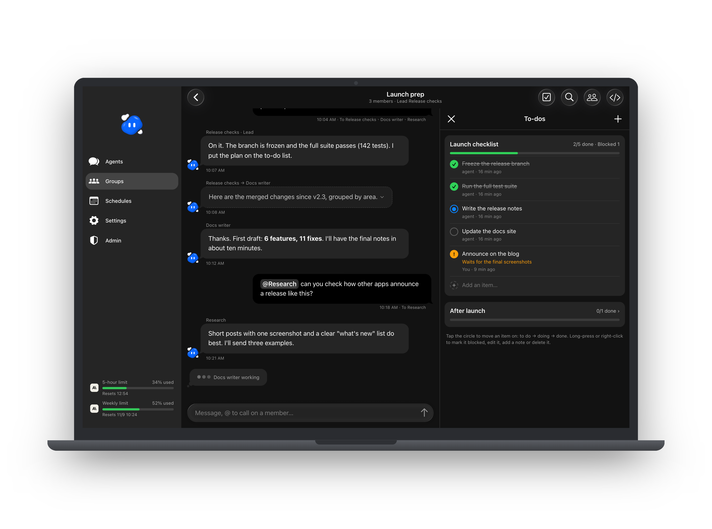

## 跨機連線：兩台電腦的 agent 互相對話

你兩台電腦上的 agent 可以互傳訊息，例如桌機上負責建置的 agent 和筆電上負責網站的 agent。兩台可以登入不同的 Claude 帳號。訊息經 SSH 在兩台之間直接傳，不經過第三方。

  <picture><source media="(prefers-color-scheme: dark)" srcset="../.github/assets/peer-link-dark.png"></picture>

- **兩台電腦配對一次。** 一台在「管理 → 跨機連線」產生一次性的配對碼，在另一台輸入。接著兩邊的管理員各按一次「啟用」，並用密碼（加驗證碼）或用密碼建立的通行密鑰確認。設定時需要一把只能執行一個指令的專用 SSH 金鑰，步驟見 [PEER-LINK.md](PEER-LINK.md)（英文）。
- **只開通你選的 agent。** 在 agent 的 Agent Profile 打開「跨機傳訊」，勾選它可以往來的另一台 agent。兩邊都要勾選對方，而且只有管理員的完整權限 agent 可以加入。
- **在原本的對話裡往來。** 用 `@` 點另一台的 agent（列在「另一台電腦」底下，名稱是「電腦/agent」），你的 agent 就會用 `peer_send` 工具把話轉過去；為了你交辦的工作，它也可以自己傳。對方的回答會回到同一個對話。送出的訊息會顯示送到哪裡、目前狀態：排隊中、已送達、過期、被拒或沒送出。另一台傳來的訊息在左側，帶著那台電腦的圖示和 agent 名稱。
- **回覆先給你看。** agent 送回另一台的回覆預設是草稿，下面有「送出」和「不送」；也可以替某個 agent 打開「自動送回回覆」。
- **內建煞車。** 收到別人的訊息之後，在你再次開口前，agent 只能回覆，不能自己開新話題。訊息只有文字，最多 8,000 字；兩個 agent 之間每小時最多 30 則；你沒開口時來回 12 次就停；排隊超過 24 小時就過期。

  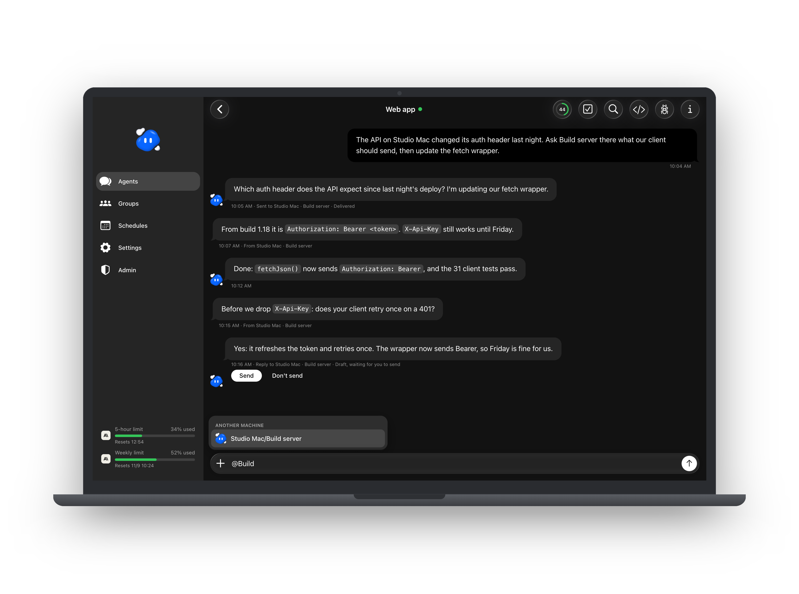

  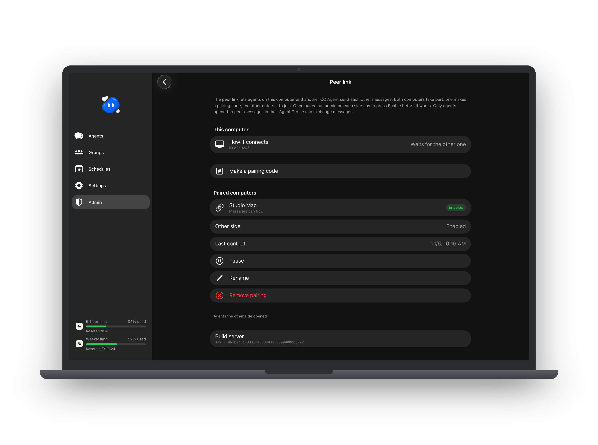

## 排程

- **定時訊息。** 可以每天、每週、每月或每隔幾小時叫醒 agent，時間可以設一個或好幾個，也可以設最後一天。勿擾時段內的通知會等時段結束再送。
- **agent 提議，你同意。** agent 可以在對話中提議排程。管理員的完整權限 agent 提議的會立刻生效；其他 agent 提議的，要等管理員在排程頁核准。
- **RSS 與 Atom。** 每次到時間，CC Agent 會自己讀 feed，只把 agent 還沒看過的新文章交給它（第一次給最新 3 篇），例如請它整理摘要。
- **背景腳本。** 到時間就執行一段 Python、Node 或 shell 小腳本，不用叫醒 agent。腳本在沙盒裡執行，只能連到你列出的網站，拿不到任何密鑰，有自己的狀態資料夾。結果可以用通知送給你，或交給 agent 處理。正式使用前可以先試跑。這項功能需要 macOS。
- **內建檢查。** 沙盒腳本做不到的檢查，可以由這台電腦的擁有者手動把唯讀指令列在 `.local/schedule-checks.json`，排程再指定要用哪一個。網頁和 agent 都不能新增。
- **尊重暫停。** 你自己暫停的 agent 不會被排程叫起來，這次執行會等它恢復。

  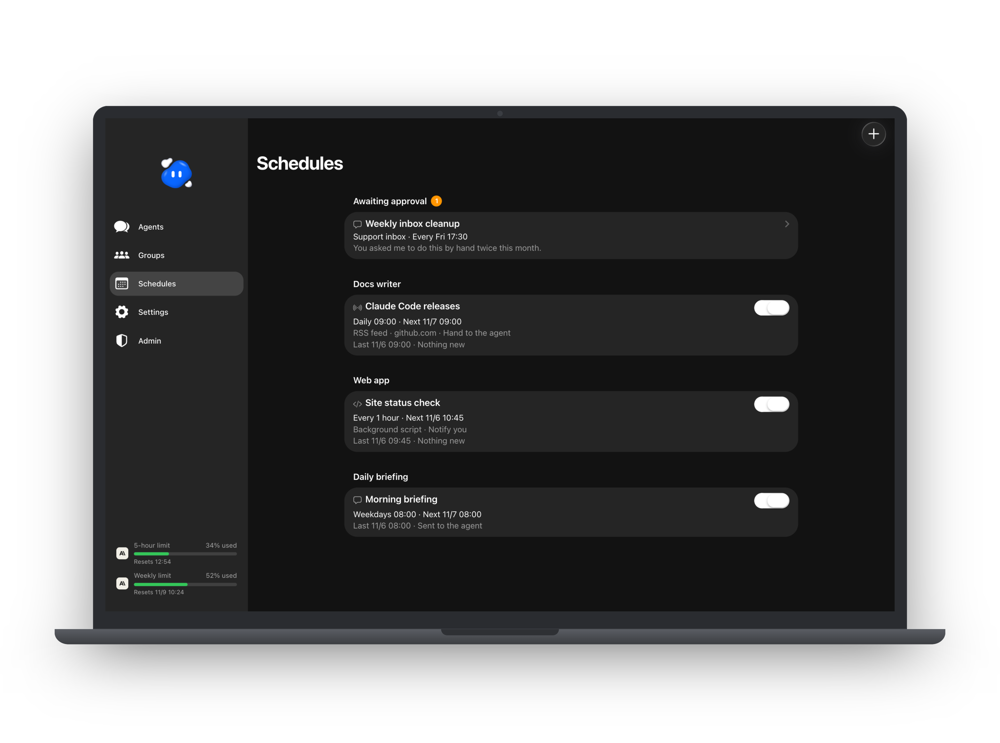

## 權限

- **完整權限。** agent 能做到你的使用者帳號在這台電腦上能做的任何事。只給你願意交出終端機的 agent。
- **限定權限的 agent。** 預設只能碰自己的工作資料夾。你可以列出它能用的資料夾（以及其中要排除的資料夾）、能連的網站、能載入的本機 MCP。它在 Claude Code 的沙盒與 auto mode 裡執行。
- **沙盒外執行的程式。** 沙盒裡跑不動的程式（例如會開瀏覽器的），管理員可以連同它的專案資料夾一起列出來。CC Agent 會在那個資料夾、用清空的環境執行它，那個資料夾對 agent 是唯讀的。
- **範圍報告單。** 限定權限的 agent 想做超出範圍的事時會被擋下，並在管理頁的「範圍報告單」開一張報告單。管理員可以忽略，或直接從報告單放寬那個 agent 的權限；放寬後 agent 會重新連線。
- **權限詢問。** Claude Code 自己的權限詢問可以在聊天室回答，agent 的工具不能代為回答。

  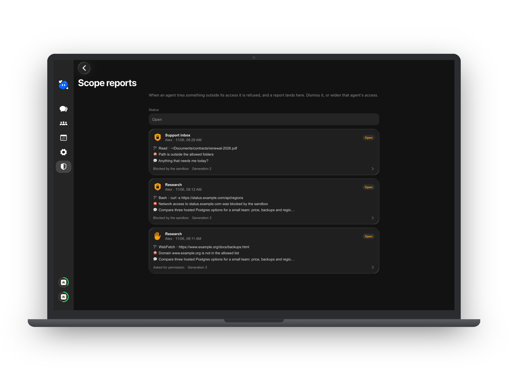

## 看得到 agent 在做什麼

- **即時進度** 顯示在聊天室裡：agent 正在用的工具、第幾步、做了多久，也看得到它是不是還在背景工作。
- **終端機檢視。** 切換到 agent 真正的 Claude Code 終端機；在電腦上可以和聊天室並排。開關要由管理員在管理頁打開。
- **Transcript 檢視。** 點任何一則訊息，就能看那一輪送給模型什麼、拿回什麼，包括工具呼叫、token、依 API 參考價估算的費用（不是實際帳單），以及 agent 開過的子代理。只有管理員能用，要在管理頁打開。
- **Context 圓環與用量。** 在電腦上，「待辦事項」按鈕旁邊的圓環顯示 agent 的 context 用了多少。點開是「用量」：context 視窗（用了多少、在哪裡自動壓縮、模型與 effort），展開可以看每個執行中子代理的 context；方案的 5 小時與每週額度；這個 agent 的自動壓縮時機，管理員可以從這裡打開 Agent Profile 調整；以及這個 agent 累計的 token 與估算費用。重新整理按鈕會再問一次。手機上「用量」在「⋯」選單裡。
- **數字從哪裡來。** 由 Claude Code 透過狀態列回報，CC Agent 會幫每個 agent 設定。你自己的狀態列會保留：完整權限的 agent，CC Agent 的指令也會執行你 Claude Code 使用者設定裡的狀態列，終端機照樣顯示它的輸出。如果 agent 的工作資料夾設定裡已經有它自己的狀態列，CC Agent 不會動它，用量畫面會說明無法顯示用量。
- **多欄並排（實驗中）。** 在電腦上，管理員可以並排顯示好幾個對話，拖曳調整欄寬和列高。每一格的標題列會用小圖示放對話頁的按鈕：context 圓環、待辦事項、搜尋和 Agent Profile，打開時還有終端機和 Transcript。格子太窄放不下時，這些會收進它的「⋯」選單。
- **圖示名稱。** 在電腦上，滑鼠停在標題列或多欄並排的圖示上，下方會顯示它的名稱。
- **Claude 用量。** 在 macOS 和 Windows 上，側欄會顯示 Claude 訂閱的 5 小時與每週額度用了多少，只有管理員看得到。
- **診斷資訊。** 給技術支援用的 agent 狀態資料，絕不包含帳號、記憶、聊天內容或憑證。

  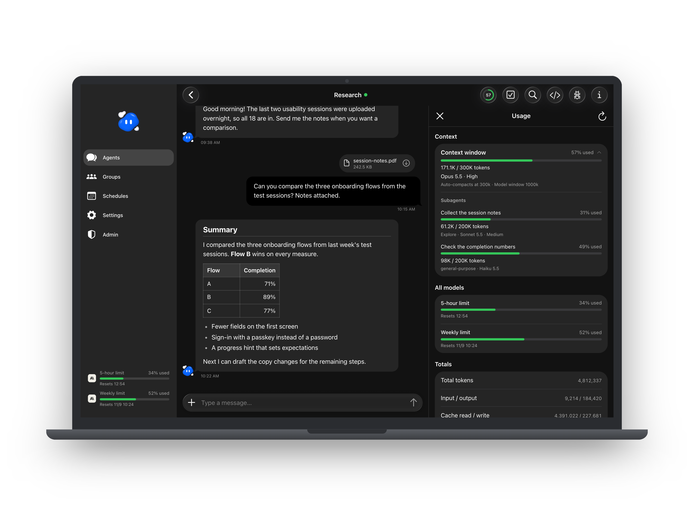

  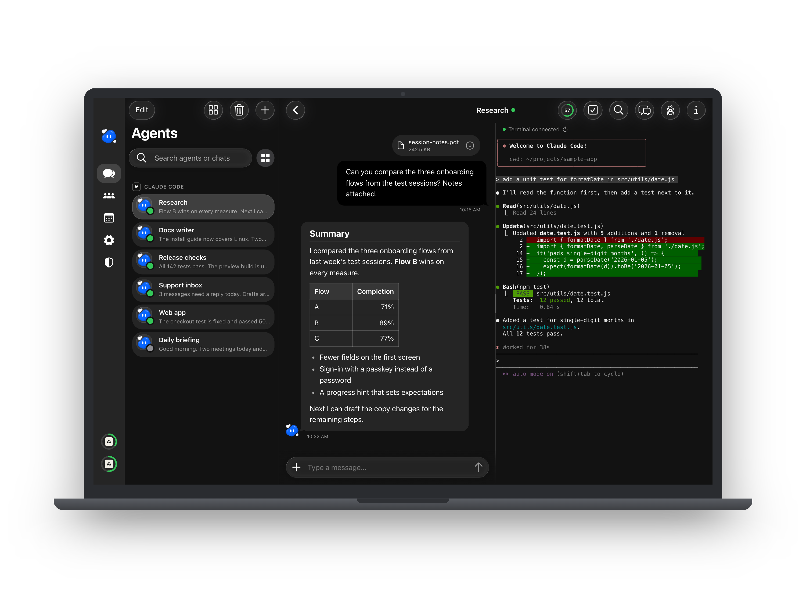

  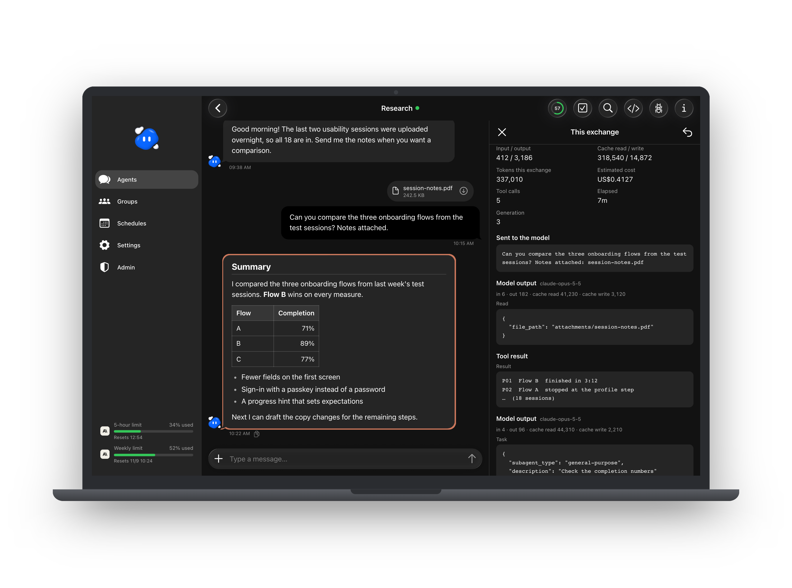

  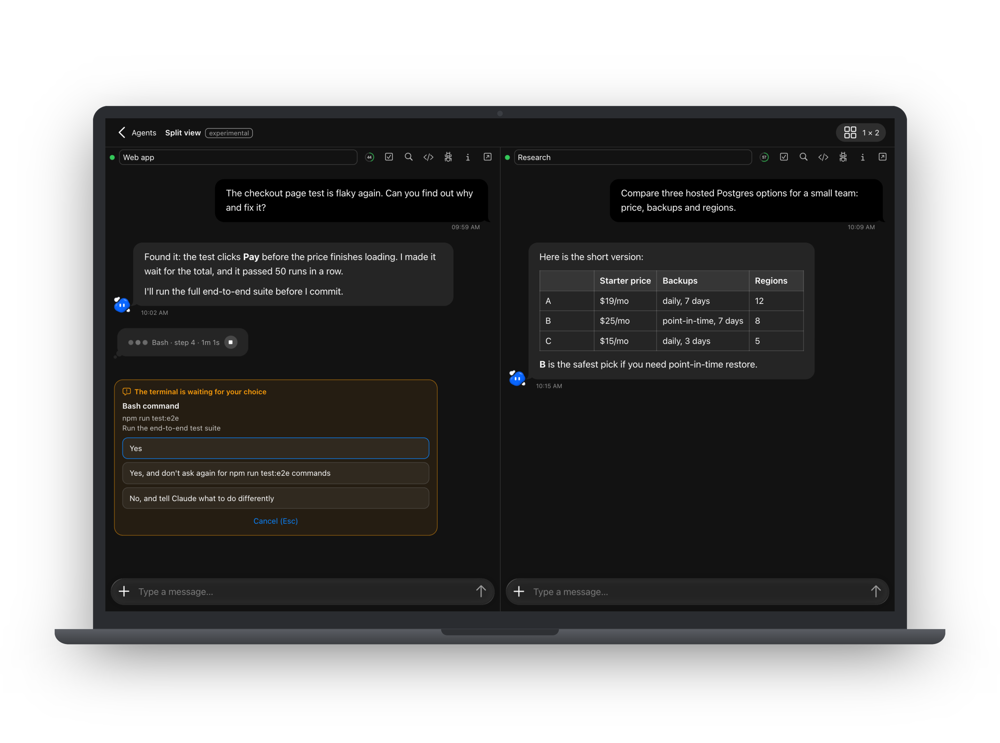

## 帳號與登入

- **管理員與使用者。** 管理員建立帳號，也建立每個人用的 agent。使用者只看得到自己的 agent。每個人都應該用自己的 Claude 方案；方案能怎麼共用，請看 Anthropic 的條款。
- **兩步驟驗證**：用驗證器 App，另外附 10 組一次性救援碼。
- **通行密鑰**：用 Face ID、Touch ID、Windows Hello 或裝置密碼登入。
- **QR 登入。** 手機上的 App 綁定一次之後，掃電腦登入頁上的 QR code，就能不用密碼登入那台電腦。確認時要選電腦上顯示的數字；那台電腦不在手機的網路裡時，手機會提醒你。
- **裝置。** 看得到所有已登入的裝置，任何一台都能登出。
- **防猜密碼。** 同一個 IP 在 15 分鐘內錯 10 次，就會被擋下不能用密碼登入：第一次擋 1 小時，再犯擋 1 天，之後擋 1 週。QR 登入不受影響。管理員可以解除。
- **針對單一帳號的猜測。** 同一個帳號名稱 1 小時內密碼錯 20 次（不論來自幾個 IP），或驗證碼 1 天內錯 10 次，就只能從它最近 30 天用過的網路用密碼登入，為期 1 小時（再發生就是 1 天）。QR 登入不受影響。

## App

- **可以安裝** 到 iPhone、Android 或電腦的主畫面。
- **推播通知**：agent 回覆或排程完成時通知你。
- **更新**：新版本上線後幾秒內就會發現，提示你更新，不會在你打字時重新載入。
- **服務重啟不會登出。** 服務重新啟動時，頁面會持續重試最多 90 秒，不會直接跳到登入畫面。
- **往下拉就關的面板。** 在手機上，待辦事項、用量、搜尋和 Agent Profile 會像 iOS 的卡片一樣打開：面板幾乎佔滿整個畫面，後面的頁面往後退並變暗。像 iOS 一樣往下拉就關掉；Agent Profile 有未保存的修改時會先問。
- **可以收合的側欄。** 在電腦上，用側欄邊緣的把手收成一排圖示，或在設定打開「自動收合電腦版選單」，滑鼠移上去才展開。
- **淺色與深色主題**，英文與繁體中文。
- **電腦本身的畫面** 不在 CC Agent 裡：要從手機看並操作 Mac，請用 [castpane](https://github.com/xxxxDev/castpane)。
